# ✨ Backdrops for Codychat 10.1

   

Give your chat a living background. **Aurora** lights drift and follow your mouse, **Constellation** stars link up and reach for your finger, **Bubbles** float up and pop when you tap them, and **Ocean Waves** swell under your pointer. Every style has a **light and a dark** version and is built for **phones and computers**. As the chat owner you decide **which ranks can use each style**.

**Author:** [M Kashif](https://github.com/cashifdev) · **License:** MIT · **Tested on:** a clean Codychat 10.1 install

## Screenshots

| Aurora | Constellation (tap = shockwave) |
|---|---|
| 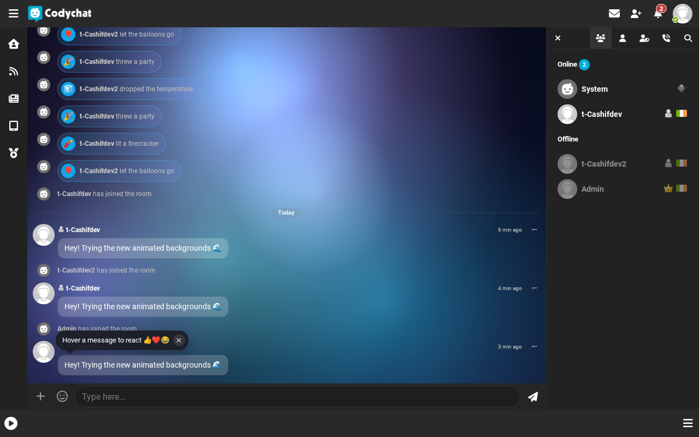 | 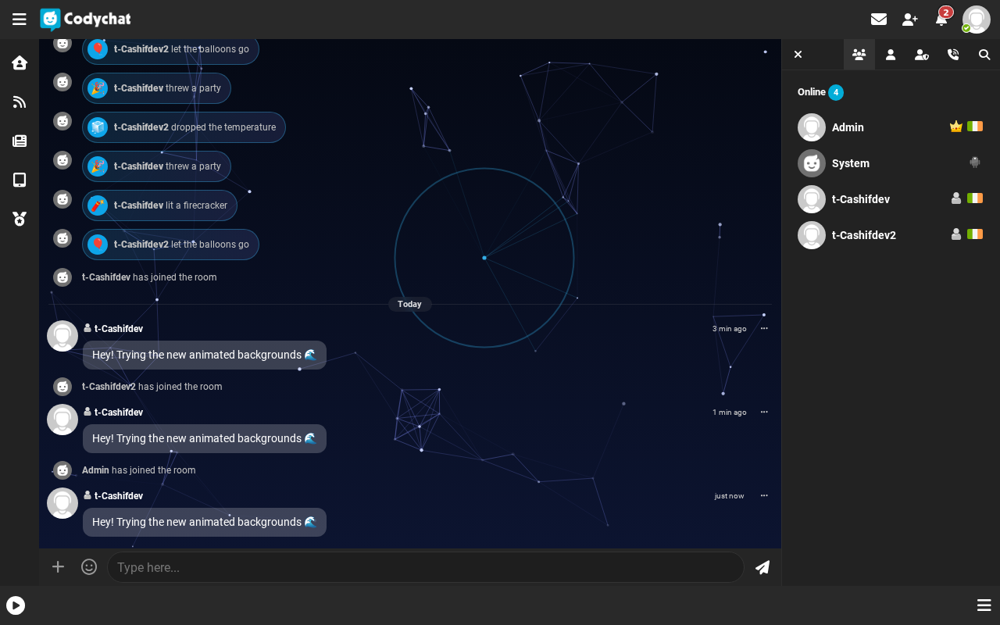 |

| Bubbles | Ocean Waves |
|---|---|
| 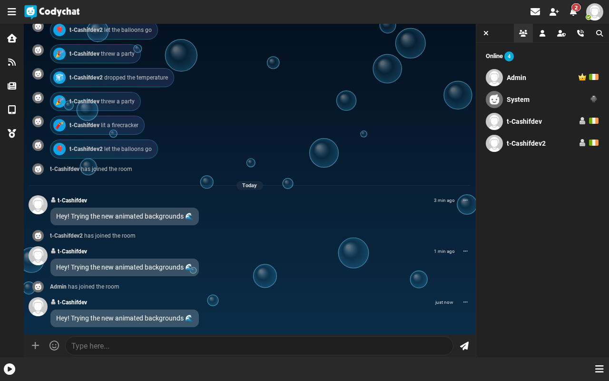 | 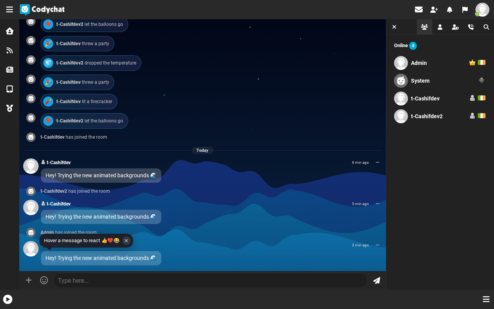 |

| Light: Constellation | Light: Ocean Waves | Picker |
|---|---|---|
| 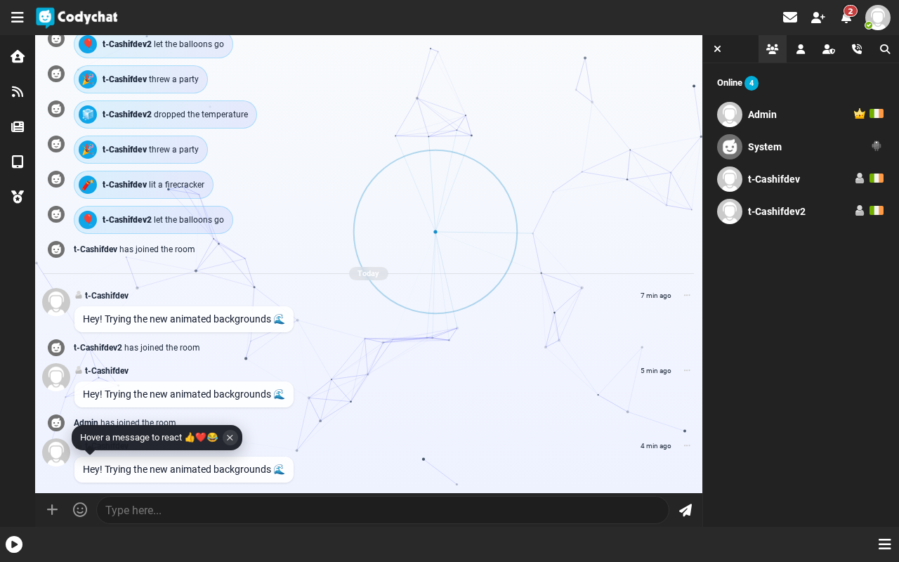 | 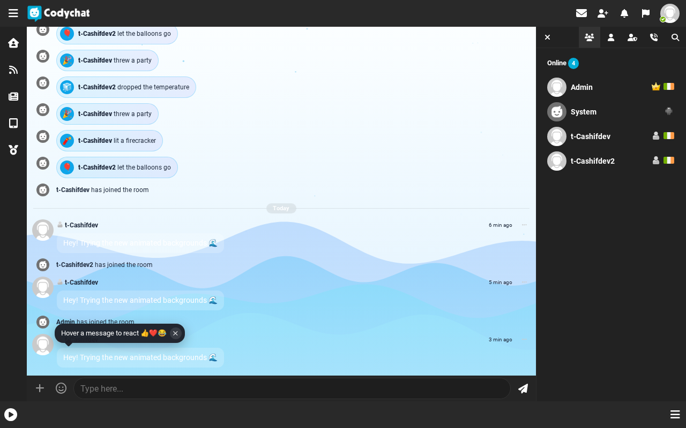 | 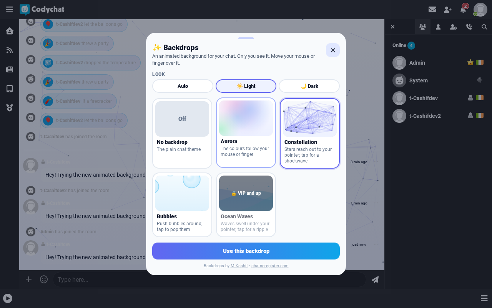 |

| Phone (light) | Phone (dark) | Phone picker (rank-locked style) |
|---|---|---|
| 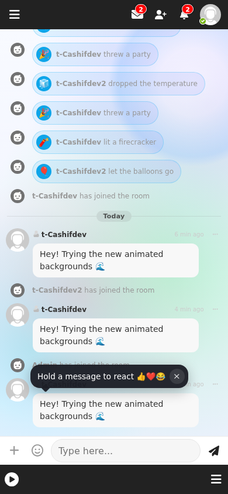 | 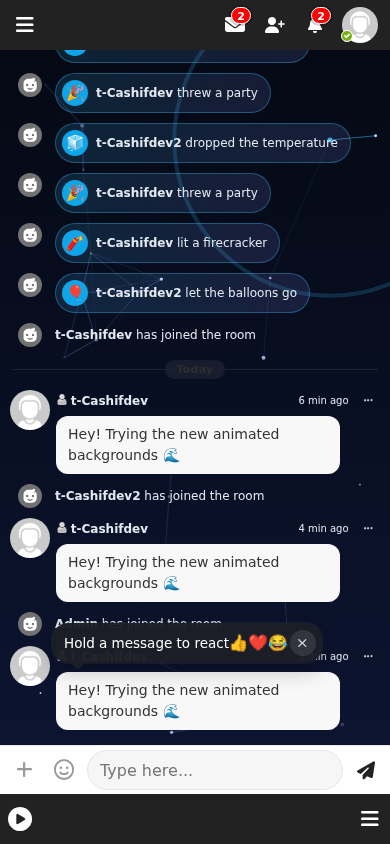 | 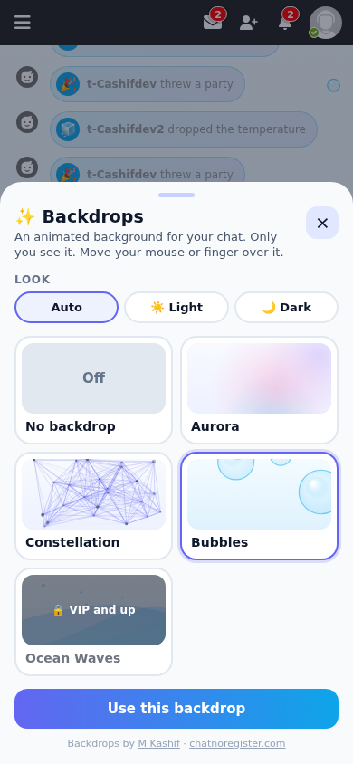 |

**Admin panel:** live previews, on/off and "who can use it" for every style

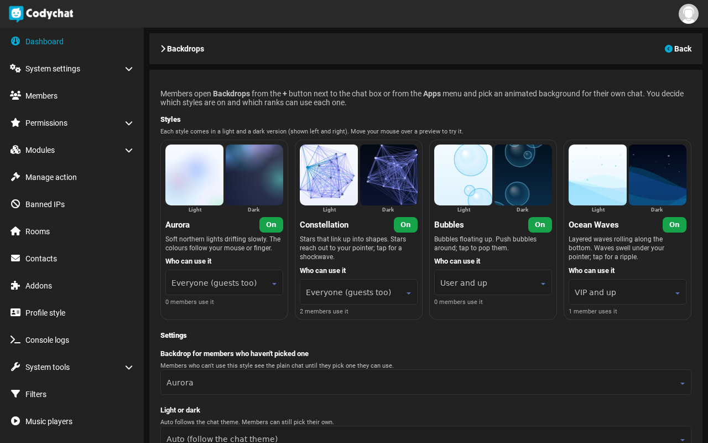

## Features
- **4 animated styles**, drawn on a canvas behind the messages:
  - **Aurora**: soft northern lights. The colours lean towards your mouse or finger, and a tap sends out a glow
  - **Constellation**: drifting stars joined by lines. They connect to your pointer and move out of its way, and a tap sends a shockwave
  - **Bubbles**: bubbles floating up. Push them around, tap one to pop it, or tap empty space to blow new ones
  - **Ocean Waves**: layered waves along the bottom. They swell under your pointer, and a tap sends a ripple along them
- **Mouse and touch**: works with a mouse on a computer and with your finger on a phone
- **Light and dark**: every style has both. **Auto** follows the chat theme. Members can choose Light or Dark themselves, and the text colours adjust so messages stay readable
- **Phones and computers**: a bottom sheet on phones and a centred window on desktop. Phones get fewer moving parts and 30 frames a second, or a still picture if you prefer
- **Rank control**: for every style choose who can use it: everyone (guests too), members, VIP, moderators, admins, super admins or the owner only. Locked styles show a 🔒 with the rank needed, and the server checks it too
- **Each member picks their own**, saved to their account. Only they see it
- A **default backdrop** for members who haven't picked one, or none
- **How busy**: calm, normal or lively
- **Live previews** of every style, light and dark, in the admin panel, plus how many members use each one
- **Its own button**: the **+** button next to the chat box and the **Apps** menu. Pick one or both
- Respects **"reduce motion"** (shows a still picture) and pauses when the tab is hidden
- **Shared hosting ready**: plain PHP and JavaScript and one small table. No WebSocket server and no Redis needed
- Optional credit line (on by default), which admins can turn off

## How it works
The backdrop is a `<canvas>` placed behind the chat messages, and the chat area is made see-through while it's on. Everything is drawn in the member's own browser, so it adds no load to your server. The member's choice is saved in one small table (`backdrops_users`). When a style is switched off or a member's rank no longer allows it, they fall back to your default backdrop (if their rank allows it) or the plain chat.

## Requirements
- Codychat **10.1**
- PHP 8.0+ (tested on 8.3), MySQL/MariaDB

## Install
1. Download this repo and upload the `backdrops` folder to `addons/` on your server, so you have `addons/backdrops/`.
2. Open your **Admin panel → Addons** and press **Install** next to *backdrops*.
3. Open its settings to choose the styles and ranks. Done.

Members tap the **+** next to the chat box, or open **Apps → Backdrops**.

## Admin settings
| Setting | What it does |
|---|---|
| Styles: On/Off | Switch any of the 4 styles on or off |
| Styles: Who can use it | Everyone (guests too), Members and up, VIP and up, Moderators and up, Admins and up, Super admins and up, or Owner only |
| Backdrop for members who haven't picked one | Any style, or no backdrop |
| Light or dark | Auto (follow the chat theme), Light or Dark, for members who haven't chosen |
| How busy | Calm, Normal or Lively |
| On phones | Full animation, Lighter animation (30 fps, fewer parts) or Still picture |
| Where the button shows | Both, only the + button, or only the Apps menu |
| Show credit link | A small "Backdrops by M Kashif · chatnoregister.com" line in the picker. Keeping it on supports free add-ons |

Out of the box: Aurora and Constellation are for everyone, Bubbles for members and up, Ocean Waves for VIP and up. Aurora is the default.

## Support
Tested on Codychat **10.1** only. Need it on Codychat 11 or an older version? Open an issue titled **[Paid install help](https://github.com/cashifdev/codychat-backdrops/issues/new?template=paid_install_help.md)**.

Found a bug? [Open a bug report](https://github.com/cashifdev/codychat-backdrops/issues/new?template=bug_report.md) with your Codychat version and what you see. See the [changelog](CHANGELOG.md) for what's new.

More free add-ons: [Shake-ups](https://github.com/cashifdev/codychat-shakeups) · [Pranks](https://github.com/cashifdev/codychat-pranks) · [Smart Alerts](https://github.com/cashifdev/codychat-smart-alerts) · [Reactions](https://github.com/cashifdev/codychat-reactions) · [GPT Bot](https://github.com/cashifdev/codychat-gpt-bot)

⭐ If Backdrops makes your chat look better, star the repo and [follow me on GitHub](https://github.com/cashifdev) for more.

See it live at **[chatnoregister.com](https://chatnoregister.com)**.
